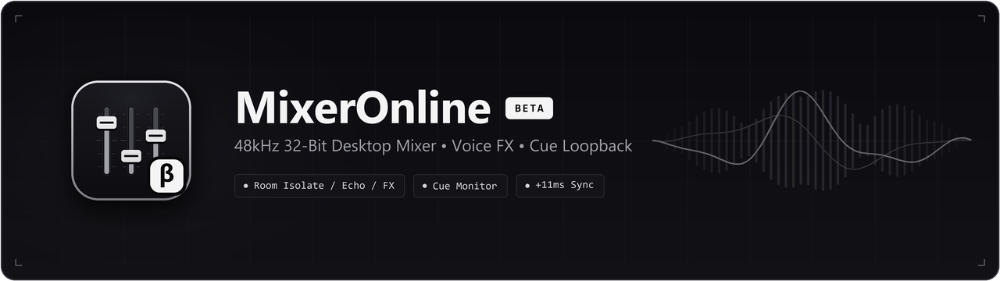

<p align="center"></p>

<p align="center">
  MixerOnline Beta (`v1.2.2-beta`) — Real-time 48 kHz 32-bit float Windows desktop audio mixer with real-time vocal Auto-Tune, zero-latency Voice FX, configurable Cue Loopback monitoring, GitHub Releases auto-update system, and Chromium tab audio isolation.
</p>

<p align="center">
  <a href="#download--install-no-coding-required">Download &amp; Install</a> &middot;
  <a href="#whats-new-in-beta-v122-beta">What's New in Beta</a> &middot;
  <a href="#core-features">Core Features</a> &middot;
  <a href="#calibrating-mic-sync-delay">Calibrating Mic Sync Delay</a> &middot;
  <a href="docs/SETUP_GUIDE.md">Setup Guide</a> &middot;
  <a href="docs/ARCHITECTURE.md">Architecture</a> &middot;
  <a href="#build--package-from-source">Build from Source</a> &middot;
  <a href="#license">License</a>
</p>

---

## Download & Install (No Coding Required)

MixerOnline Beta ships as a portable, self-contained Windows x64 application paired with a Manifest V3 Chromium extension. No .NET runtime or Visual Studio installation is required.

### 1. Download the Beta Release Archive
1. Open the **Releases** page on GitHub and download `MixerOnline-beta-v1.2.2-win-x64.zip`.
2. Extract the archive into a permanent folder (referred to below as `<extracted-folder>`).

### 2. Install VB-Audio Virtual Cable (One-Time Setup)
Windows requires a virtual audio driver so Discord, OBS, or Zoom can receive MixerOnline's output as a microphone source.
1. Download the free driver from [VB-Audio Virtual Cable](https://vb-audio.com/Cable/).
2. Extract the driver archive, right-click `VBCABLE_Setup_x64.exe`, and choose **Run as administrator**.
3. Reboot Windows if prompted. You can verify the driver afterward by running `.\scripts\setup_vbcable.ps1` or opening **Setup Guide** inside MixerOnline Beta.

### 3. Load the Chromium Browser Extension
Load `<extracted-folder>\extension` in **any supported Chromium browser**:

| Browser | Extensions Page |
|---|---|
| Google Chrome | `chrome://extensions` |
| Brave | `brave://extensions` |
| Microsoft Edge | `edge://extensions` |
| Opera / Opera GX | `opera://extensions` |
| Vivaldi | `vivaldi://extensions` |
| Arc | `arc://extensions` (or `chrome://extensions`) |

1. Open your browser's extensions page from the table above (or click **Browser Extensions** in MixerOnline Beta's bottom toolbar).
2. Enable **Developer mode** in the top-right corner.
3. Click **Load unpacked** and select `<extracted-folder>\extension`.
4. Pin **MixerOnline Audio Bridge** to your toolbar for quick access.

> **Note:** Firefox is **not supported**. MixerOnline relies on Chromium's `chrome.tabCapture` and `chrome.offscreen` Manifest V3 APIs to isolate audio from a single browser tab without capturing desktop notifications or other tabs.

### 4. Launch and Route Audio
1. Double-click `MixerOnline-beta.exe` inside `<extracted-folder>`.
2. In **01 Browser Audio**, pick the tab you want to stream (such as YouTube, Spotify Web, or Twitch).
3. In **02 Microphone**, select your physical microphone and optionally choose a **Voice FX** preset.
4. In **03 Master Output**, confirm the primary target is `CABLE Input (VB-Audio Virtual Cable)`.
5. In Discord, OBS Studio, Zoom, Google Meet, or TikTok Live Studio, set your **Input / Microphone Device** to:
   ```text
   CABLE Output (VB-Audio Virtual Cable)
   ```

---

## What's New in Beta (`v1.2.2-beta`)

### Collapsible Voice FX & Auto-Tune Cards
Microphone channel (02) clutter is now solved with collapsible module cards:
- **Collapsible Voice FX & Auto-Tune:** Both Voice FX and Auto-Tune can now be minimized into sleek, compact single-line headers showing live preset status and detected musical note. Clicking anywhere on the module header or chevron toggles expand/collapse.
- **Preference Persistence:** Collapsed/minimized states are automatically remembered and restored between sessions in `%APPDATA%\MixerOnline-beta\beta-settings.json`.

### Modern Dark Minimalist Scrollbar
- Fixed the stark white Windows desktop scrollbar mismatch in the **Settings** dialog. Implemented a custom dark graphite WPF ScrollBar (`#27272a` rounded thumb, transparent track, hover to `#3f3f46`) that perfectly matches the studio aesthetic.

### Cleaned Toolbar & In-App Auto-Update Verification
- Removed the redundant "Extension Folder" and "Browser Extensions" buttons from the bottom status bar for an uncluttered layout.
- Fully wired for testing the new automated GitHub Releases update delivery system from `v1.2.1-beta`.

---

## What's New in Beta (`v1.2.1-beta`)

### Automated GitHub Releases Auto-Update System (`UpdateService.cs`, `UpdateApplyHelper.cs`)
MixerOnline Beta now includes a built-in, zero-downtime automated updater that checks against the GitHub Releases API (`https://api.github.com/repos/novascatia/MixerOnline/releases`):
- **Semantic Version Engine (`SemanticVersion.cs`):** Full SemVer 2.0 comparison supporting pre-release tags (`1.2.1 > 1.2.1-beta`, `1.2.2-beta > 1.2.1-beta`, tag prefix normalization `v1.2.1 == 1.2.1`).
- **Interactive Update Notification Pill:** Non-intrusive cyan badge in the top header (`✨ vX.X.X Available`) appears automatically on startup when a new release or beta build is detected.
- **Dedicated Console Update Dialog (`UpdateDialog.xaml`):** View side-by-side version comparison, Markdown release notes / changelogs, download progress bar with real-time percentage, and one-click "Download & Restart".
- **Zero-Downtime Windows Binary Replacement (`UpdateApplyHelper.cs`):** Seamlessly solves Windows executable locking issues by executing a detached, hidden PowerShell handoff script (`apply_update.ps1`) that waits for the host PID to cleanly exit, extracts the update archive or replaces binaries, purges staging caches, and restarts the updated MixerOnline.
- **Configurable Settings & Channel Selection:** Configure auto-check frequency and toggle beta pre-release channel updates directly in **Settings -> Software Updates**, with an instant manual "Check Now" button.

### Real-Time Vocal Auto-Tune / Pitch Correction (`AutoTuneProcessor.cs`)
MixerOnline Beta now features a high-performance, low-latency vocal pitch correction engine built directly into the microphone signal path:
- **Two-Tier Sub-Hertz Pitch Tracking:** Combines 12 kHz decimated autocorrelation with 48 kHz parabolic interpolation to detect vocal fundamentals ($70–1050\text{ Hz}$) with high accuracy and $< 0.5\%$ CPU overhead. Automatically bypasses unvoiced consonants and breaths to eliminate warbling artifacts.
- **Musical Scale Quantizer:** Select from all 12 Root Keys (`C, C#, D, D#, E, F, F#, G, G#, A, A#, B`) and 3 Scale modes:
  - **Chromatic:** Quantizes to all 12 musical semitones (nearest note).
  - **Major:** Quantizes to natural major scale degrees (`W-W-H-W-W-W-H`).
  - **Minor:** Quantizes to natural minor scale degrees (`W-H-W-W-H-W-W`).
- **Retune Speed Slider:**
  - **Hard Snap (`0%`, ~2ms):** Iconic robotic Cher / T-Pain / Travis Scott instantaneous stepped pitch quantization.
  - **Fast / Tune (`15–25%`, ~15ms):** Snappy modern commercial pop vocal tuning.
  - **Natural (`30–60%`, ~35ms):** Preserves natural vocal vibrato and vocal inflection while locking pitch to scale notes.
  - **Soft (`70–100%`, ~80ms):** Subtle pitch stabilization.
- **Live Pitch Note Readout:** Real-time console badge displaying detected note and cents error (e.g. `A4 (+6¢)`, `C#4 (-12¢)`, or `--` when silent).
- **Zero-Glitch Overlap-Add Resampler:** 16 ms vocal grains with Hann windowing, click-free bypass crossfade, and wet/dry Mix slider (`0–100%`).

### Zero-Latency Voice FX (`VoiceEffectProcessor.cs`)
Every vocal effect runs sample-by-sample with **zero samples of dry lookahead delay** so microphone timing never drifts against browser music. Switching presets or toggling back to `Clean` crossfades smoothly over ~10 ms (`480` frames) with no clicks or pops mid-sentence, controlled by the **FX Mix** slider (`0–100%`, default `75%`):

| Preset | Processing Topology |
|---|---|
| **Clean** | Bit-exact bypass with zero DSP overhead when settled. |
| **Room Isolate** | 4th-order `110 Hz` Butterworth high-pass filter, `290 Hz` boxiness notch, fast downward expander/noise gate, `3.5 kHz` vocal presence lift, `14 kHz` air low-pass, and gentle `2.5:1` compressor. |
| **Echo** | Stereo ping-pong delay (`220 ms` Left / `310 ms` Right) with in-loop `240 Hz` high-pass, `3.0 kHz` low-pass damping, and soft `tanh` feedback protection. |
| **Telephone** | 4th-order bandpass (`340 Hz`–`3.2 kHz`), `1.35 kHz` nasal resonance peak, asymmetric soft-clip saturation with `20 Hz` DC blocker, and speech leveler. |
| **Radio** | Broadcast EQ curve (`75 Hz` HPF, `145 Hz` warmth, `380 Hz` de-mud, `4.5 kHz` clarity), `3:1` optical-style compressor with `4 dB` soft knee, and soft limiter. |
| **Hall** | `160 Hz` pre-send HPF feeding a 4-comb stereo Schroeder network (`+73`-sample L/R spread) with high-frequency damping and 2 series all-pass diffusers per channel. |

### Configurable Loopback / Headphone Monitor (`Listen To`)
Choose exactly what you hear in your local headphones via the **Listen To** selector inside **03 Master Output**:

- **Music (Default):** Sends only browser audio (with Key / Tone transpose applied) through a dedicated monitor limiter so you can sing or speak over backing tracks without hearing your own microphone slapback.
- **Mic:** Sends only your processed microphone signal to headphones while preserving direct browser tab playback if enabled.
- **Both:** Sends the full limited master mix (`Music + Mic`).

Beta's monitor path runs with low-latency WASAPI buffering (`Math.Min(LatencyMs, 15)` ms with automatic fallback), triggers immediate `RequestLowLatencySync()` on start, and trims buffer drift in `MonitorSampleProvider.cs` whenever buffered frames exceed `1920` (trimming back to `480` frames / `10 ms`) so clock differences between VB-Cable and your headphone DAC never accumulate stale delay.

### Shared Settings Compatibility (`SettingsManager.cs`)
MixerOnline Beta shares core configuration (`SelectedMicId`, `SelectedOutputId`, `SelectedMonitorId`, gains, `MicDelayMs`, `LatencyMs`, `BridgePort`) with Stable in `%APPDATA%\MixerOnline\settings.json` (falling back to legacy `%APPDATA%\MixerOnline-beta\settings.json` if present), while storing Beta-exclusive preferences (`VoiceEffectMode`, `VoiceEffectIntensity`, `MonitorSourceMode`) separately in `%APPDATA%\MixerOnline-beta\beta-settings.json` via atomic temporary-file writes.

---

## Core Features

| Capability | Details |
|---|---|
| **Exclusive Tab Capture** | Isolates audio from one selected tab across Chrome, Brave, Edge, Opera, Vivaldi, or Arc via Web Audio `AudioWorklet` (`48 kHz` stereo Float32 PCM) with WebRTC APM processing bypassed. |
| **Real-Time Vocal Auto-Tune** | Sub-hertz pitch tracking, 12 root keys, Chromatic/Major/Minor scales, Retune Speed (Hard Snap -> Natural), wet/dry mix, and live note cents display. |
| **Zero-Latency Voice FX** | 5 vocal presets (Room Isolate, Echo, Telephone, Radio, Hall) with 0 dry lookahead latency and click-free crossfading. |
| **48 kHz 32-Bit Float Mixing Bus** | Stereo summing engine (`AudioMixerBus.cs`) with exponential gain smoothing (`0.015f` per frame) and dedicated master and monitor soft-knee limiters. |
| **Key / Tone Transposer (`-6` to `+6` semitones)** | Dual-grain synchronous overlap-add pitch shifter (`PitchShifter.cs`) using 50 ms grains and a 4096-sample Hann window to transpose music without altering tempo. |
| **Mic Sync Delay (`0–200ms`)** | Sample-accurate circular delay line (`DelayLine.cs`) with smooth slew control, `0ms` / `45ms` / `80ms` quick presets, and a low-latency `+11ms` Beta default. |
| **Soft-Knee Limiter** | Mastering peak limiter (`AudioLimiter.cs`) passing signals 1:1 below `-0.5 dBFS` (`0.94f`) and smoothly limiting peaks below `0.999f` (`-0.001 dBFS`). |
| **Custom Bridge Port** | Loopback WebSocket port (default `49876`, valid range `1025–65534`) configurable in both desktop **Settings** (`Local Bridge Port`) and the extension popup (**Bridge Port** -> **Apply**). |
| **Console UI & Device Resilience** | Dark 3-channel workspace with `BETA` badge, 30 FPS Peak & RMS LED VU meters, system tray minimization, and automatic WASAPI hot-plug recovery. |

---

## Calibrating Mic Sync Delay

Because browser tab audio passes through Chromium's `AudioWorklet`, local loopback WebSocket transport, and MixerOnline's `AdaptiveJitterBuffer` cushion, browser audio arrives slightly behind a live hardware microphone. In Beta, `VoiceEffectProcessor` adds **0 samples** of dry lookahead delay, so switching Voice FX presets never alters your mic-to-music sync.

Use this quick calibration check (typically `+11ms` to `+45ms`):

1. Keep **Headphone Monitor** set to `Music` (or OFF while listening directly in browser), and record a short test clip in OBS Studio or Audacity capturing `CABLE Output (VB-Audio Virtual Cable)`.
2. Play a steady metronome, drum loop, or song in your selected browser tab.
3. Clap your hands or sing crisp syllables (`"tah, tah, tah"`) on the beat.
4. Listen back to the recorded output:
   - **If your voice/clap lands before the beat (early):** increase **Mic Sync Delay** from the `+11ms` Beta default toward `+25ms`–`+45ms` (or click the `45ms` preset and fine-tune).
   - **If your voice/clap lands after the beat (late):** lower **Mic Sync Delay** toward `0ms`.
   - **If using larger `Audio Buffer Size` (`50 ms` or `100 ms` in Settings):** test values between `+45ms` and `+80ms`+ until claps land cleanly on the beat.

---

## Audio Engine Specifications

| Parameter | Specification |
|---|---|
| **Internal Mixing Format** | 48,000 Hz, 32-bit IEEE Float, Stereo |
| **Capture & Output API** | Windows WASAPI (Shared Event-Driven) |
| **Browser Transport** | Loopback WebSocket (`ws://127.0.0.1:<port>/ws`, default `49876`, Origin-validated) |
| **Audio Buffer Presets** | `15 ms`, `30 ms` (default), `50 ms`, `100 ms` |
| **Monitor Buffer Latency** | `Math.Min(LatencyMs, 15)` ms with automatic drift trimming above `1920` frames |
| **Key Transposer** | `-6` to `+6` semitones (1-semitone steps, tempo-preserving) |
| **Voice FX Modes** | `Clean`, `Room Isolate`, `Echo`, `Telephone`, `Radio`, `Hall` (`FX Mix` 0–100%) |
| **Mic Sync Delay** | `0–200 ms` UI slider (`0–300 ms` DSP engine capacity, Beta default `+11 ms`) |
| **Soft-Knee Limiter** | `0.94f` (`-0.5 dBFS`) knee threshold, `0.999f` (`-0.001 dBFS`) peak ceiling |
| **Metering Refresh** | 30 FPS Peak & RMS ballistics |

---

## Project Structure

```text
MixerOnline-beta/
├── .github/workflows/release.yml   # GitHub Actions build, test, and pre-release workflow
├── docs/
│   ├── assets/                     # Beta brand banner and logos (PNG / SVG)
│   ├── ARCHITECTURE.md             # Technical architecture, Voice FX & monitor drift spec
│   └── SETUP_GUIDE.md              # Step-by-step setup, FX guide, and troubleshooting
├── extension/                      # Chromium Manifest V3 Audio Bridge extension
│   ├── manifest.json               # Permissions & MV3 configuration
│   ├── background.js               # Tab enumeration, filtering, and stream ID setup
│   ├── offscreen.html / .js        # Web Audio API host & WebSocket client
│   ├── pcm-processor.js            # 48 kHz Float32 AudioWorklet packetizer
│   ├── popup.html / .js            # Toolbar popup UI & Bridge Port editor
│   └── README.md                   # Extension installation & port reference
├── scripts/
│   ├── build.ps1                   # Build application & run automated verification suite
│   ├── package.ps1                 # Publish self-contained x64 EXE & release ZIP in dist/
│   └── setup_vbcable.ps1           # Diagnostic check for VB-Audio Virtual Cable
├── src/MixerOnline.App/            # .NET 8 WPF Mixing Console Application
│   ├── Controls/                   # Custom console fader & dual stereo LED VU meters
│   ├── Core/Audio/                 # AudioEngine, MixerBus, VoiceEffectProcessor, MonitorSampleProvider
│   ├── Core/Config/                # AppSettings & SettingsManager (shared + beta JSON)
│   ├── Core/Network/               # BrowserBridgeServer (Origin-guarded WS / /status)
│   ├── Core/Utils/                 # BrowserLauncher (Chromium detection & extension URL)
│   ├── ViewModels/                 # MainViewModel & MVVM commands
│   └── Views/                      # SettingsDialog & SetupGuideDialog
├── tests/MixerOnline.Tests/        # Automated DSP and integration test suite
├── .gitignore
├── LICENSE                         # MIT License
└── README.md
```

---

## Build & Package from Source

### Prerequisites
- Windows 10 or Windows 11 (x64)
- [.NET 8 SDK (`8.0.x`)](https://dotnet.microsoft.com/download/dotnet/8.0)

### Build and Run Automated Verification Suite
```powershell
.\scripts\build.ps1 -Configuration Release
```
This builds `MixerOnline.App` and executes the automated DSP and integration test suite in `tests\MixerOnline.Tests\Program.cs`, verifying core audio and bridge components plus Beta's `VoiceEffectProcessor` (zero dry latency, stability sweeps, per-mode DSP responses), `MonitorSampleProvider` drift trimming, `MonitorSourceMode` routing, and `SettingsManager` shared/beta round-trip persistence.

### Create Portable EXE & GitHub Release Archive
```powershell
.\scripts\package.ps1
```
All release outputs are created cleanly inside `dist\`:
- `dist\MixerOnline-beta.exe` — Self-contained single-file Windows x64 executable
- `dist\MixerOnline-beta-v1.2.0-win-x64.zip` — Portable archive containing `MixerOnline-beta.exe`, `extension\`, `README.md`, `LICENSE`, and `docs\`

---

## License

Licensed under the **MIT License** (`Copyright (c) 2026 MixerOnline Contributors`). See [LICENSE](LICENSE) for full terms.

VB-Audio Virtual Cable is a third-party driver provided by VB-Audio Software as freeware for personal use.
